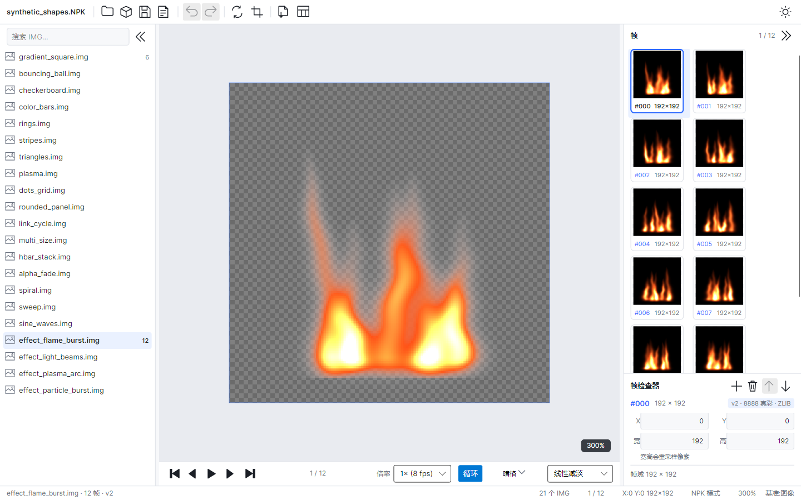
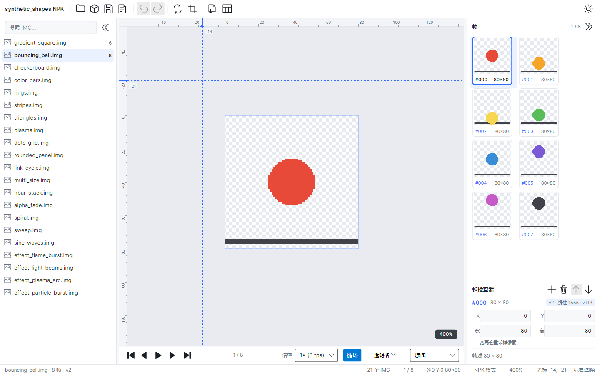
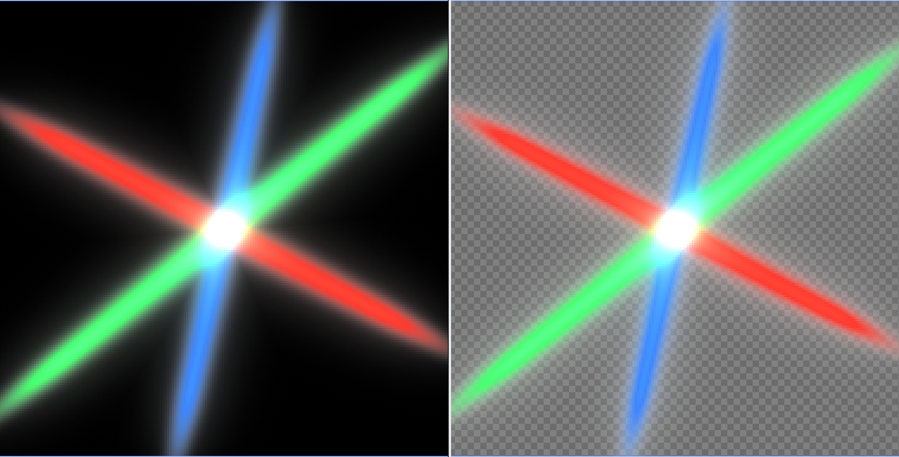
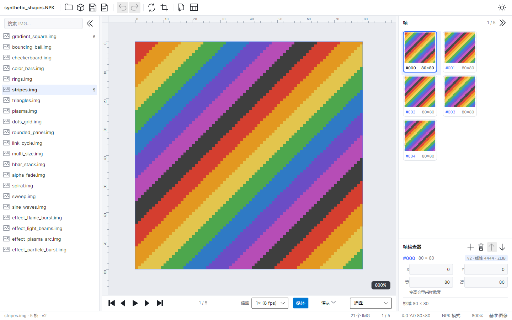

# NPKStudio

**DNF（地下城与勇士）IMG / NPK 资源查看与编辑工具**，Avalonia 11 + .NET 10 实现 —— 单文件、免安装。

A viewer and editor for DNF `.NPK` / `.img` game resources, rewritten with [Avalonia](https://avaloniaui.net/) 11 on .NET 10.



## 功能

- **打开** `.NPK` 资源包、单个 `.img`，或整个文件夹（子文件夹视为一个 NPK）；支持拖放
- **帧浏览**：条目列表走 Avalonia 默认虚拟化面板；帧缩略图按显示尺寸解码，超过 80 帧只生成前 80 张（点选仍可查看与导出）
- **播放**：9 档倍率（0.25×–4×，1× = 8 fps）、循环、空格键播放/暂停、方向键逐帧
- **帧编辑**：替换素材（PNG/BMP/JPG）、插入、删除、上移/下移、改坐标与宽高、拖拽排序
- **撤销 / 重做**：Ctrl+Z / Ctrl+Y，栈深 50，变更标记告诉你动过哪几帧
- **隐藏帧**：H 键临时隐藏，只影响预览与播放，不改文件
- **精确对位**：标尺、参考线、十字辅助线、像素对齐（缩放吸附整数档 + 最近邻绘制）、图像/角色双坐标基准
- **背景 7 档**：透明格 / 亮格 / 暗格 / 纯黑 / 深灰 / 浅灰 / 绿幕
- **效果 2 档**：原图 / 线性减淡（黑底当透明，接近游戏内观感），按 IMG 记住选择
- **导出**：当前帧 PNG、批量 PNG、整段动画 GIF
- **写回**：另存 NPK（未改动的条目逐字节保持不变）
- **打包**：文件夹 + 资源清单 → NPK，可与客户端已有 NPK 合并
- **多语言**：中文 / English，运行时切换，新增语言只需加一份 JSON
- **单文件发布**：`NPKStudio.exe` 双击即用，目标机器无需安装 .NET



## 效果预览：原图 vs 线性减淡



同一帧、同样 300% 缩放：**左「原图」，右「线性减淡」+ 暗格背景**。图中是样本里的
`effect_light_beams`——红 / 绿 / 蓝三束柔光从画面边缘射向中心，每束都带连续的横向衰减；
三束在中心相交，三个颜色通道相加成近白，所以交叉点比任意单束都亮。

DNF 的特效贴图通常是**不透明黑底（RGB 全 0、alpha 255）+ 发光层**。原图模式下它就是一块黑方块
上面浮着光；切到「线性减淡」后，黑底被当成透明打穿（`alpha = min(alpha, 亮度)`），
只剩发光，于是透出背景。**暗色背景下更容易看出暗部如何变成透明**：光晕越暗的地方越透，
棋盘格从外缘一点点透出来；而三束光叠加的中心因为 RGB 相加接近白色，反而更亮、更不透明。

**什么时候该用**：在 PVF 的 `.ani` 里看这个 IMG 有没有标 `[GRAPHIC EFFECT] LINEARDODGE`。
标了就选「线性减淡」，没标就保持「原图」；透明底的普通素材选它几乎看不出区别，也不该选。

## 快速开始

### 方式一：下载 Release（推荐）

到本仓库的 **Releases** 页面下载 `NPKStudio-<version>-win-x64.zip`，解压后双击 `NPKStudio.exe`。
免安装、免运行时，示例包在压缩包的 `示例/` 目录里（程序化生成的几何图形样本，见下文"许可证"）。

### 方式二：从源码构建

需要 [.NET SDK 10.0](https://dotnet.microsoft.com/download) 或更高版本。

```bash
dotnet build -m:1
dotnet test
dotnet run --project src/NPKStudio.Desktop
```

> `-m:1` 是刻意限制并行构建：本项目对构建顺序敏感，单进程构建才能稳定复现 0 warning。

发布单文件版本（产物在 `dist/`）：

```bash
python tools/pack.py
```

版本号只有一个来源：`src/NPKStudio.Desktop/NPKStudio.Desktop.csproj` 的 `<Version>`。
界面标题、exe 文件属性、zip 文件名都读它，任何地方都不要另写版本号。

## 命令行用法

无界面模式，适合批量处理：

```bash
# 扫描一个装满 NPK 的目录，反向生成资源清单
NPKStudio.exe --scan-paths "<NPK目录>" --out "<清单.txt>"

# 把导出文件夹批量打回 NPK（--base 指定客户端 ImagePacks2 时按同名条目合并）
NPKStudio.exe --pack "<导出根目录>" --manifest "<清单.txt>" --out "<输出目录>" --base "<客户端 ImagePacks2 目录>"
```

`.img` 文件本身不记录它在 NPK 里的完整路径，所以打包必须依赖资源清单（纯文本，每行 `IMG: sprite/...`）。
不加 `--base` 会直接覆盖同名 NPK，丢掉包里原有条目；需要保留就用合并模式。



## 项目结构

```
.
├─ src/
│  ├─ NPKStudio.Core/          格式层：IMG / NPK 解析与编码，零 UI 依赖、零第三方包
│  └─ NPKStudio.Desktop/       Avalonia 11 桌面端（MVVM，编译绑定）
├─ tests/
│  ├─ NPKStudio.Core.Tests/    Core 单元测试（字节级往返 + 合成样本）
│  ├─ NPKStudio.Desktop.Tests/ Desktop 无头 UI 测试（Avalonia.Headless）
│  ├─ NPKStudio.Benchmarks/    性能基准（可指向自备的真实大包）
│  └─ samples/                 测试样本：自带一个合成包，真实样本请自备
├─ tools/
│  ├─ pack.py                  单文件发布打包脚本
│  └─ make-sample/             合成样本生成器（几何图形，MIT）
├─ docs/
│  ├─ 使用说明.txt             面向使用者的中文教程
│  ├─ ARCHITECTURE.md          内部架构说明
│  └─ images/                  README 截图（均由合成样本生成）
├─ Directory.Build.props       公共编译属性
└─ NPKStudio.sln
```

## 版本支持

| IMG 版本 | 状态 | 说明 |
| --- | --- | --- |
| v1 / v2 | ✅ 已验证 | 已用真实客户端包逐字节验证，读写完整 |
| v4 / v5 / v6 | ⚠️ 实验性 | 能读能写，但按旧实现推导，尚无真实样本逐字节验证；保存前会二次确认 |
| v7 / v8 / v9 | ⛔ 仅透传 | 无法解析帧，只能原样保存 |

不支持 OGG 音频播放。`.ogg` 条目按原始字节透传。

## 多通道播放（规划中，尚未实现）

当前一次只显示一个 IMG。数据层已经按"可容纳 N 个通道"设计：
`ChannelCollection` 持有通道列表并由 `ActiveChannel` 决定当前显示，追加通道不会影响其它通道的选中、播放与编辑状态。
每个通道也有自己的播放机（`ChannelPlayback`），但界面只显示活动通道，没有新建通道入口，也没有多通道同屏布局。
所以这一功能**尚未实现**，不要按已可用理解。

## 许可证

[MIT](LICENSE) © 2026 NPKStudio contributors

格式层的实现参考了 [ExtractorSharp](https://github.com/d-mod/ExtractorSharp)（MIT，© 2017 Kritsu）的源码并重写。

仓库里唯一的测试样本 `tests/samples/synthetic_shapes.NPK` 由
[`tools/make-sample`](tools/make-sample) 用代码生成（渐变、圆形、棋盘格、色条，以及黑底多层发光的
`effect_flame_burst` / `effect_light_beams` / `effect_plasma_arc` / `effect_particle_burst` 等纯几何图形），不含任何游戏美术，以 MIT 随仓库分发；
`docs/images/` 下的截图同样由这个合成样本渲染而成。
真实客户端 NPK 属于第三方版权资产，**不随仓库分发**：需要时请自备，放在
`tests/samples/real_sample.NPK`（已被 `.gitignore` 忽略），详见
[tests/samples/README.md](tests/samples/README.md)。
